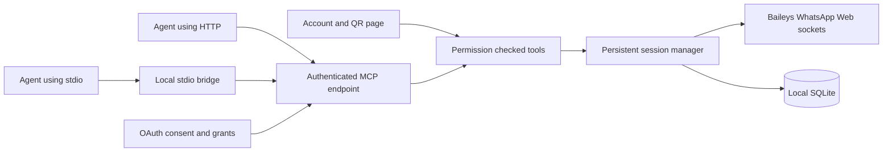

# Architecture

`src/driver.ts` is the only transport adapter. Tests inject a simulated adapter;
production uses the pinned Baileys package. `src/sessions.ts` owns one runtime
per account, coalesces simultaneous starts, serializes provider events and sends,
persists credentials and Signal keys, and handles QR expiry and reconnects.

`src/store.ts` uses Node's SQLite module with WAL, account-scoped indexes and
AES-256-GCM encrypted records bound to their record identity. Signal key writes
commit before the adapter promise resolves. It does not use the example
multi-file auth store. The database writer lease expires after 20 seconds and is
renewed every 5 seconds; session key writes and sends check ownership. A process
that loses the lease closes its service. Stdio clients never own this lease or
open a second WhatsApp socket.

An account is bound to its first phone identity. If a later pairing reports a
different phone, the service stops that session, invalidates account credentials
and rejects its incoming history. The operator must create another account.
Logout removes cryptographic session state while preserving local history. It
also invalidates previously issued account keys and dependent OAuth grants.

`src/access.ts` verifies owner/account keys. Account keys are stored by hash in
encrypted records with permissions, expiry and credential epoch. `src/mcp.ts`
checks permissions and account scope regardless of which transport invokes it.
Responses never include raw auth credentials. Provider text and group metadata
are returned as untrusted data.

`src/oauth.mjs` implements authorization-code grants on the MCP SDK auth router:
PKCE S256, exact registered redirect matching, resource binding, CSRF validation,
consent, one-use codes, refresh rotation and grant revocation. OAuth records are
encrypted with a key derived from the master key and authenticated to the record
identity. Native account-key revocation is rechecked for OAuth requests. The
owner access key is checked by digest in existing owner grants after rotation.

`src/service.ts` serves stateless Streamable HTTP MCP requests, the operator page
and OAuth metadata. Stateless HTTP requests still share the persistent session
manager. `src/cli.ts stdio` is a protocol bridge to that service. Standard MCP
clients do not need an OpenAI, Anthropic, Google or other model API key here.

The operator page keeps its access key in memory, uses same-origin requests and
checks response generation/expiry before displaying a QR. It contains no message
composer, campaign editor or bot configuration.

History synchronization is incremental and bounded by the linked-device
protocol. `latest_batch_received` means a latest history batch was observed, not
that all phone history is available. Message reads query the local store. Group
membership and recipient checks query the connected account.

Primary transport references: [QR pairing](https://baileys.wiki/authentication/qr-code),
[session persistence](https://baileys.wiki/authentication/session-management),
[JID identity](https://baileys.wiki/concepts/jids) and
[history synchronization](https://baileys.wiki/advanced/history-sync).
